# ⚡ ARCline: High-Performance Terminal AI Agent

[](https://nodejs.org)
[](https://www.typescriptlang.org)
[](https://zod.dev)
[](https://vitest.dev)
[](https://www.npmjs.com/package/arcline)
[](LICENSE)

> **Autonomous terminal intelligence engineered for developer flow.**  
> ARCline tackles the fundamental context window limit by transforming your local machine into a persistent, external context engine.

---

## 💡 The Core Philosophy: Durable Memory vs. Ephemeral Context

Modern LLM context windows are vast, but treating them as infinite scratchpads leads to high latency, degraded reasoning, and context rot. ARCline treats the developer's filesystem as an **external, durable memory tier**:

```mermaid
flowchart LR
    subgraph DeveloperWorkspace["Developer Workspace"]
        Files["Codebase Files"]
        Rules["ARCLINE.md / CLAUDE.md"]
        SessionStore["~/.config/arcline/sessions"]
    end

    subgraph ARClineEngine["ARCline Engine"]
        CLI["Interactive Terminal REPL"]
        Compaction["Context Estimator & Dynamic Compactor"]
        ToolExecutor["Permission-Gated Tool Dispatcher"]
    end

    subgraph LLMProviders["Universal Model Hub"]
        Models["OpenAI / DeepSeek / OpenRouter / Local vLLM"]
    end

    DeveloperWorkspace <-->|Persistent Context & State| ARClineEngine
    ARClineEngine <-->|Compacted, High-Signal Prompting| LLMProviders
```



* **Durable Project Rules**: Automatically loads conventions from `ARCLINE.md`, `CLAUDE.md`, or `.arcline/instructions.md` without consuming re-prompt tokens.
* **Intelligent Compaction**: When conversational context approaches token limits, ARCline compresses historical exchanges into structured summaries while preserving active tasks, tool outputs, and system guidelines.
* **Local Session Persistence**: Sessions survive shell disconnects and are archived under `~/.config/arcline/sessions` for resumption anytime.

---

## ⚡ Key Features

* **🖥️ Streaming Terminal REPL**: Ultra-responsive token streaming with animated progress spinners (`ora`), formatted diffs, and syntax highlighting (`chalk`).
* **🔌 Universal Provider Support**: Native integration with OpenAI, DeepSeek, OpenRouter, Groq, and local inference engines (Ollama, LM Studio, vLLM).
* **🛠️ Sandboxed System Tools**:
  * **Filesystem**: Read, edit, multi-line replace, and search project files.
  * **Terminal Execution**: Run shell commands, tests, and build scripts with user-permission safety barriers.
  * **Git Operations**: Inspect diffs, track staging, and create commits with commit message generation.
* **🧠 Context Compaction Thresholds**: User-configurable token headroom ensuring models never run into `context_length_exceeded` runtime crashes.

---

## 📦 Installation & Setup

### Global Installation via npm
```bash
npm install -g arcline
```

### Quick Start
Launch an interactive agent session in your current repository:
```bash
arcline
```

### Provider Configuration
Configure your API endpoint, API key, and preferred model interactively:
```bash
arcline config
```

You can also use environment variables for headless environments or CI:
```bash
export ARCLINE_BASE_URL="https://api.openai.com/v1"  # Or DeepSeek, OpenRouter, Ollama
export ARCLINE_API_KEY="your-api-key"
export ARCLINE_MODEL="gpt-4o"
arcline
```

---

## 🕹️ In-Session Slash Commands

While inside the interactive `arcline>` session:

| Slash Command | Description |
| :--- | :--- |
| `/clear` | Purge transient conversation history while retaining project instructions |
| `/model` | Dynamically switch between discovered models without terminating session |
| `/config` | Review and update active provider credentials and parameters |
| `/help` | Print active keyboard shortcuts and available capabilities |
| `/exit`, `/quit` | Save session state and exit cleanly |

---

## 📁 Project Structure

```
arcline/
├── src/
│   ├── cli/                    # CLI parsing, commander setup, interactive prompts
│   ├── agent/                  # Agent loop, multi-turn reasoning, tool execution
│   ├── context/                # Token estimators, session persistence, compaction
│   ├── providers/              # OpenAI-compatible streaming API clients
│   ├── tools/                  # Filesystem, shell runner, and git tool interfaces
│   └── ui/                     # Terminal rendering, spinners, diff coloring
├── dist/                       # Production compiled JavaScript bundle
└── test/                       # Unit and integration test suites (Vitest)
```

---

## 🛠️ Local Development

### Prerequisites
* **Node.js**: v20.0.0 or higher
* **npm** or **pnpm**

### Building from Source
```bash
# Clone the repository
git clone https://github.com/kaizxark/arcline.git
cd arcline

# Install dependencies
npm install

# Run TypeScript compiler in watch mode
npm run dev

# Execute unit tests
npm run test

# Build production distribution
npm run build
```

---

## 🗺️ Engineering Roadmap

- [x] Streamlined interactive terminal REPL with dynamic tool approvals
- [x] Context estimation and session auto-compaction
- [x] Project instruction discovery (`ARCLINE.md`, `CLAUDE.md`)
- [ ] Model Context Protocol (MCP) server integration
- [ ] Semantic vector search over local codebase files using sqlite-vec
- [ ] Multi-agent orchestration for parallelized code auditing and test execution

---

## 📜 License & Author

Engineered by **Shaik Mohammed Ehtesham** ([@kaizxark](https://github.com/kaizxark)) under the **MIT License**.
